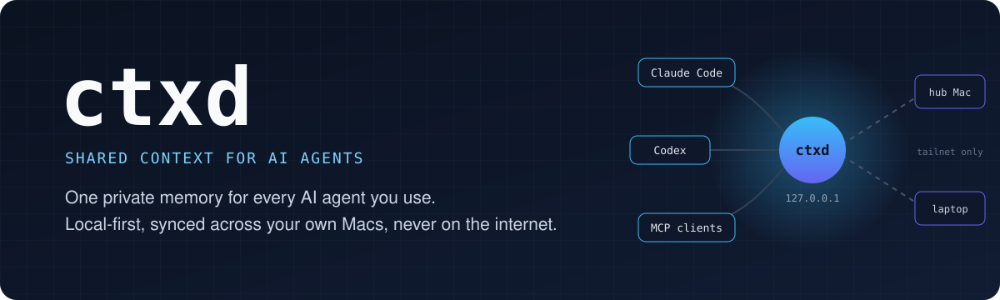
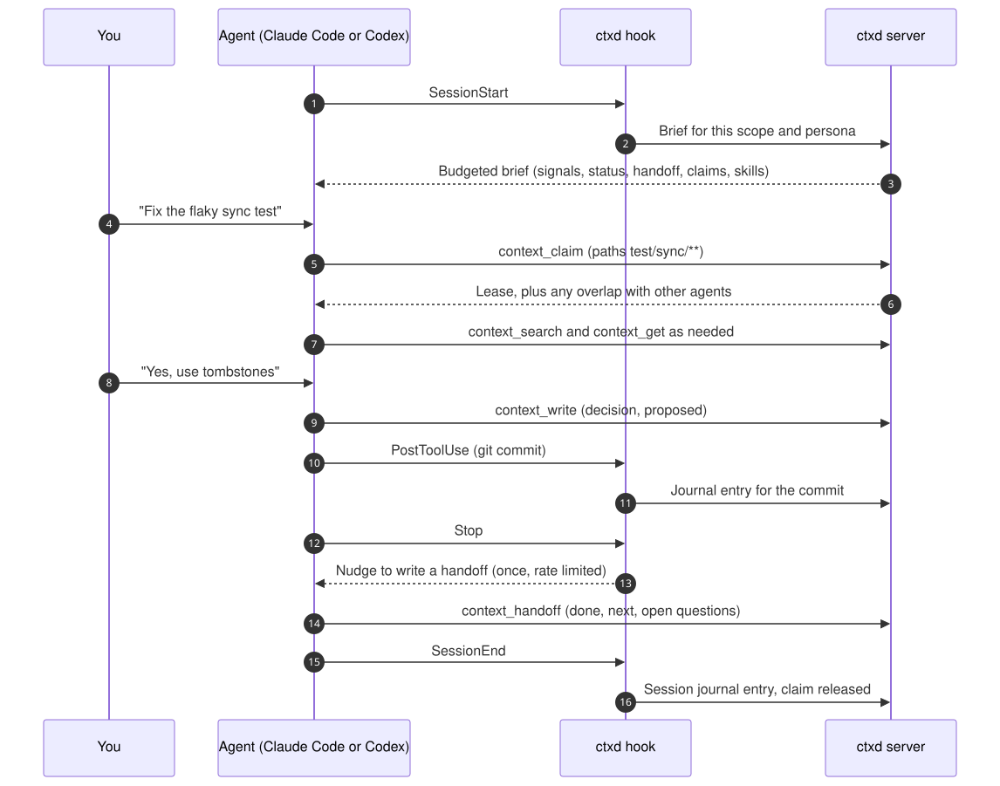

<p align="center">
  
</p>

<p align="center">
  
  
  
  
  
</p>

<p align="center">
  <a href="#why-ctxd">Why</a> ·
  <a href="#what-an-agent-sees">What agents see</a> ·
  <a href="#architecture">Architecture</a> ·
  <a href="#features">Features</a> ·
  <a href="#security-and-privacy">Security</a> ·
  <a href="#roadmap">Roadmap</a> ·
  <a href="#documents">Docs</a>
</p>

---

**ctxd** is a small, local-first context store that every AI agent you use can read from and write to over [MCP](https://modelcontextprotocol.io). Claude Code, Codex, Claude Desktop and other clients share one memory: what you decided, where work stands, the conventions to follow, what the last session handed off, how you like things done, and the procedures that worked.

It runs on your own Macs, with a full replica on each one, and syncs privately over Tailscale. Nothing listens on the public internet.

## Why ctxd

| Without ctxd | With ctxd |
|---|---|
| Every new session starts from zero, and you re-explain the project | Each session starts with a compact brief: status, the last handoff, open blockers, decisions |
| Claude's memory never reaches Codex, and the other way around | One store shared by every MCP client, with every write attributed to its agent |
| Switching tools mid-task means pasting summaries | The next agent picks up the handoff the last one wrote |
| Parallel agents collide on the same files | Claims declare which paths an agent will touch, so overlaps are caught before work starts |
| A lost session takes its knowledge with it | Hooks capture handoffs and journal entries automatically at session boundaries |
| A hosted memory is one more thing exposed to the internet | Loopback only; replicas sync over your tailnet |

## What an agent sees

When a session starts, a hook injects a budgeted brief. There is no tool call to make and nothing to remember. An example (all names invented):

```text
ctxd brief · sample-app · 2026-10-18 09:02 · node laptop · synced 3m ago

NOTICES
- Interrupted work: your previous session was working on "sync apply" (last seen 22:41).
  Check recent commits and the working tree before redoing anything.
- 2 proposed entries await review.

OPEN SIGNALS
- BLOCKER (2d): sealed-pool tests need a Keychain stub, ctxd:sample-app/01JAC…

STATUS     Sync engine: pull path done; push path in progress.
HANDOFF    codex@laptop: tombstones implemented; next is conflict tests (test/sync/**).
CLAIMS     claude-code@laptop · "push path cleanup" · src/sync/** · 40m
DECISIONS  Use an event log, not cr-sqlite (cr-sqlite is dormant).
MEMORY     Prefers numbered document versions · No em dashes in prose
SKILLS     - release-checklist: cut a release (bump, changelog, tag, verify)
LESSONS    Run sync property tests with 2,000 cases; 500 missed the tombstone bug.
(more: ctxd://sample-app/decisions/)
```

Mid-session, agents use seven small MCP tools (`context_brief`, `context_search`, `context_get`, `context_write`, `context_handoff`, `context_flag`, `context_claim`), whose definitions cost under 1,500 tokens in total.

## Architecture

### The big picture

Each Mac runs one `ctxd server`. Agents reach it only on `127.0.0.1`; replicas reach each other only through `tailscale serve` on the tailnet.

<picture>
  <source media="(prefers-color-scheme: dark)" srcset="docs/assets/diagrams/overview-dark.svg">
  
</picture>

<sub>Source: [overview.mmd](docs/assets/diagrams/overview.mmd)</sub>

### When agents read and write

Continuity does not depend on an agent remembering to use a tool. Lifecycle hooks do the work at session boundaries; instructions and explicit requests cover the rest.

<picture>
  <source media="(prefers-color-scheme: dark)" srcset="docs/assets/diagrams/lifecycle-dark.svg">
  
</picture>

<sub>Source: [lifecycle.mmd](docs/assets/diagrams/lifecycle.mmd)</sub>

### Every write takes one path

Agents, hooks and the CLI all write through one function. The event log is the source of truth, and everything an agent reads is materialized from it.

<picture>
  <source media="(prefers-color-scheme: dark)" srcset="docs/assets/diagrams/write-path-dark.svg">
  
</picture>

<sub>Source: [write-path.mmd](docs/assets/diagrams/write-path.mmd)</sub>

### Personas decide who sees what

Agents belong to persona pools. Each session assumes exactly one persona and sees that pool's scopes plus the global `_me`. Nothing crosses pools unless a scope is placed in both.

<picture>
  <source media="(prefers-color-scheme: dark)" srcset="docs/assets/diagrams/personas-dark.svg">
  
</picture>

<sub>Source: [personas.mmd](docs/assets/diagrams/personas.mmd)</sub>

### Replicas converge, online or not

Every Mac keeps the full event log of the scopes it may hold and pulls what it has not seen yet, so each one works offline and catches up later. Each part of an entry is versioned separately, so approving an entry on one Mac while an agent links it on another is never a conflict.

<picture>
  <source media="(prefers-color-scheme: dark)" srcset="docs/assets/diagrams/replication-dark.svg">
  
</picture>

<sub>Source: [replication.mmd](docs/assets/diagrams/replication.mmd)</sub>

## Features

| | |
|---|---|
| **Hooks first** | SessionStart briefs, a Stop-hook nudge for handoffs, PreCompact checkpoints, journal entries for sessions and commits, and a crash sweep for sessions that die. Claude Code and Codex, with a conformance kit per client version |
| **Typed knowledge** | Decisions, conventions, status, facts, lessons, handoffs, tasks, pointers, notes, preferences, skills and journal entries, each with provenance, history and per-part revisions |
| **Memory about you** | Preferences, conventions and lessons in `_me`, with per-persona profiles. "Remember that..." in any session proposes one |
| **Skills** | Reusable procedures in `SKILL.md` form, approved once, listed in every brief, and optionally synced into Claude Code and Codex |
| **Journal** | A time-ordered log per project with significance; blockers stay pinned in briefs until resolved; weekly digests |
| **Browse it like files** | Every entry has a `ctxd://` path; folders carry one-line and overview summaries; `ctxd ls`, `tree` and `read`; an optional Markdown mirror |
| **Claims** | Write intent as path globs, overlap warnings, a drift audit on release, and facts-first takeover of stale claims |
| **Persona pools** | Default-deny access, one persona per session, holding scopes, access requests you approve, and sealed pools |
| **Easy cleanup** | Flag an entry, quarantine everything from one agent or session, revert or release, roll back a scope, or purge for real |
| **Small footprint** | Seven tools under 1,500 tokens, briefs capped to fit inline, and errors that say what to do next |

The filesystem view, for people and agents alike:

```text
ctxd://
├── _me/                     preferences/  conventions/  profile/  lessons/  skills/  journal/
├── _me.pool-notes/          the same layout, for one persona
└── sample-app/
    ├── .abstract  .overview  brief.md
    ├── status/  decisions/  conventions/  facts/  lessons/  handoffs/  tasks/
    ├── skills/release-checklist/SKILL.md
    └── journal/2026/10/18.md
```

## Security and privacy

- **No public endpoint, ever.** Listeners bind to `127.0.0.1`, and sync is exposed only to the tailnet with `tailscale serve`. Never `0.0.0.0`, never Funnel ([ADR 0003](docs/adr/0003-no-public-endpoint.md)).
- **Secrets never land.** A sanitization pipeline strips `<private>` blocks and hidden or bidirectional characters, then rejects agent writes that look like secrets and redacts them from hook captures.
- **Review before trust.** Agent-written decisions, conventions, preferences and skills stay proposed until you approve them; skills and preferences can never be approved automatically.
- **Every write is attributed** to an agent, a session and a machine, with full history and prior values.
- **Retrieved text is data, not instructions.** Agents are told so, and every entry carries a provenance line.
- **Names stay local.** Repositories hold no ctxd files, and this repository uses only invented project and pool names.

## Roadmap

| Milestone | Scope | Status |
|---|---|---|
| M0 | PRD, spec, ADRs, scaffold | ✅ Done |
| M1 | Single-node core: event log, MCP tools, search, persona pools, redaction, flag and purge | 🚧 Core modules in place, server next |
| M2 | Hooks for Claude Code and Codex, claims, cleanup, journal from hooks, open signals, skill catalog | Planned |
| M3 | Replication between Macs over Tailscale | Planned |
| M4 | Hub deployment: launchd, backups, phone SSH, status line | Planned |
| M5 | Semantic search, Desktop chats, rollback, tidy, importance ranking, digests, native skill sync | Planned |
| M6 | Signed events, Markdown mirror and export, Mac Studio with a local model, sealed pools | Planned |

## Documents

The PRD is a parent document plus component PRDs that reference each other. Each document is versioned by file name (`-v1`, `-v2`, and so on), and earlier versions stay for tracking.

| Document | Purpose |
|---|---|
| [PRD v6](docs/prd/PRD-v6.md) (parent) | Vision, goals, scope, requirements, milestones, risks, and the index of component PRDs |
| [Knowledge model](docs/prd/components/PRD-knowledge-model-v3.md) | What is stored: kinds, statuses, versioned parts, references and paths, relationships, history |
| [Persona pools and access](docs/prd/components/PRD-pools-access-v2.md) | Who sees and writes what: personas, tokens, sealed pools, holding scopes, access requests |
| [Hooks and agent lifecycle](docs/prd/components/PRD-hooks-v5.md) | **When agents read and write**: hooks, the Stop-hook nudge, per-client behavior, crash sweep |
| [Claims and write intent](docs/prd/components/PRD-claims-v3.md) | Task claims, write intent, overlap, drift, stale-claim takeover |
| [Trust and safety](docs/prd/components/PRD-trust-safety-v4.md) | Redaction, capture filters, path guard, provenance, review queue, tokens |
| [Context hygiene](docs/prd/components/PRD-context-hygiene-v1.md) | Flag, quarantine and revert, rollback, purge, tidy |
| [Replication and offline work](docs/prd/components/PRD-replication-v4.md) | Per-machine replicas, sync over Tailscale, per-part conflicts |
| [Briefs and search](docs/prd/components/PRD-briefs-search-v4.md) | What agents receive: tiers, open signals, skill catalog, importance, caps, ergonomics |
| [Filesystem view](docs/prd/components/PRD-filesystem-view-v1.md) | `ctxd://` paths, folder summaries, browsing, the Markdown mirror |
| [Skills](docs/prd/components/PRD-skills-v1.md) | Shared, approved, versioned procedures for every agent |
| [Memory and journal](docs/prd/components/PRD-memory-journal-v1.md) | Preferences, the journal, digests, open signals, importance |
| [Spec v6](docs/spec/SPEC-v6.md) | Architecture, data model, MCP tools, hooks, sync, access, cleanup, security, operations |
| [Prior art v4](docs/research/prior-art-v4.md) | Related projects and what was adopted |
| [ADRs](docs/adr/) | Key decisions |

## Development

```bash
nvm use        # Node 24
npm install
npm run typecheck
npm test
```

Coding agents follow [AGENTS.md](AGENTS.md), including the Claude Code built-in skills every change goes through (`/run`, `/simplify`, `/verify`, `/code-review` and others) and the definition of done.

Architecture diagrams are pre-rendered from `docs/assets/diagrams/*.mmd`; after editing one, run `docs/assets/diagrams/render.sh`.

To watch a build's progress in Claude Code (slices, tests, typecheck, the definition of done, git and PRs), start it with the [ctxd-build mod](tools/claude-mods/ctxd-build/): `claude --plugin-dir tools/claude-mods/ctxd-build`.

<details>
<summary>Source layout</summary>

```
src/cli      command entry points
src/core     HLC clock, ids, errors, dates, token estimates, kinds
src/tools    MCP tool contracts, definitions, alias coercion, server instructions
src/security sanitization pipeline, detectors, network and vendor policies
src/access   persona pools, access levels, traversal rule
src/claims   write-intent normalization, overlap test, drift
src/model    entry references and importance
src/fsview   ctxd:// paths and slugs
src/skills   SKILL.md validation, catalog lines, sync rendering
src/journal  time filters, open signals, weekly digest
src/hooks    nudge state machine, scope resolution from git origin, bypass
src/store    schema and write path
src/sync     pull protocol and event apply
src/brief    brief assembly
src/search   ranking
deploy/      launchd and client configuration examples
tools/       the ctxd-build Claude Code mod
```

</details>

## Privacy of names

Repositories never contain ctxd configuration, and nothing in this repository uses real project, scope or pool names. Bindings between repositories and scopes live only in ctxd's local data. All examples here are invented.
