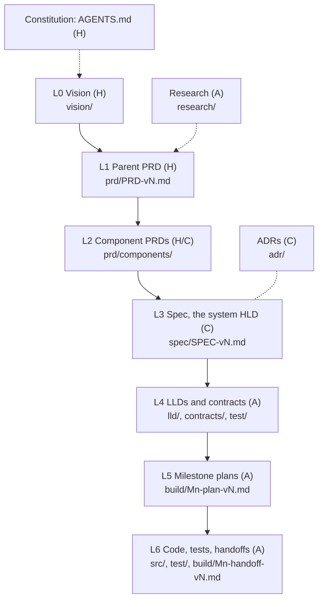

# ctxd Documentation Map

| | |
|---|---|
| **Owner** | A, maintained by persona `doc-steward`; updated in the same change that adds or versions any document |
| **Date** | 2026-10-20 |
| **Standards** | [Spec-driven development](standards/spec-driven-development-v1.md) (who writes what), [Agent personas](standards/agent-personas-v1.md) (who the agents are) |

Start here. This page lists every documentation layer, where it lives, and its **latest version**, so no agent has to search for it. Older versions stay in place for history; never edit them.

## Layers

| Layer | Folder and naming | Latest | Owner | Writes it |
|---|---|---|---|---|
| Constitution | [AGENTS.md](../AGENTS.md) (unversioned; changed by the owner) | current | H | the owner |
| L0 Vision | `vision/vision-vN.md` | [Vision v1](vision/vision-v1.md) (draft for the owner's review) | H | the owner (`analyst` may interview) |
| L1 Parent PRD | `prd/PRD-vN.md` | [PRD v8](prd/PRD-v8.md) | H, with C sections | the owner; `product-writer` |
| L2 Component PRDs | `prd/components/PRD-<component>-vN.md` | Table below | H and C, acceptance criteria A | the owner; `product-writer` |
| L3 System HLD | `spec/SPEC-vN.md` | [Spec v10](spec/SPEC-v10.md) | C | `architect`, decided at Gate 2 |
| L4 LLDs | `lld/LLD-<component>-vN.md` | Table below | A | `component-designer`, `security-reviewer`, `sre` |
| L4 Contracts | `contracts/<surface>-vN.md` | [MCP tools v1](contracts/mcp-tools-v1.md), [CLI reference v1](contracts/cli-reference-v1.md) | A, human review at Gate 3 | `component-designer` |
| L4 Test plan | `test/test-plan-vN.md` | [Test plan v1](test/test-plan-v1.md) | A | `test-architect` |
| L5 Plans | `build/M<n>-{kickoff,plan}-vN.md` | Per milestone in [build/](build/) | A | `planner` |
| L6 Evidence | `build/M<n>-handoff-vN.md`, `src/`, `test/` | Per milestone in [build/](build/) | A | `implementer`, checked by `verifier` |

Beside the stack:

| Artifact | Where | Latest | Owner |
|---|---|---|---|
| Research and prior art | `research/<topic>-vN.md` | [Prior art v4](research/prior-art-v4.md) | A (`analyst`) |
| Decisions | `adr/NNNN-<decision>.md`, numbered once, superseded never versioned | [0001](adr/0001-local-first-replicated-store.md), [0002](adr/0002-event-log-sync.md), [0003](adr/0003-no-public-endpoint.md), [0004](adr/0004-embeddings-replicate.md) | C (`architect` drafts, the owner decides) |
| Runbooks | `runbooks/<task>-vN.md` | [Hub migration v1](runbooks/hub-migration-v1.md) | A (`sre`) |
| Templates | `templates/<artifact>-template.md`, one per artifact, each section tagged H, C or A with its persona | [templates/](templates/) | H (the owner approves the sections) |
| Standards | `standards/<topic>-vN.md` | [Spec-driven development v1](standards/spec-driven-development-v1.md), [Agent personas v1](standards/agent-personas-v1.md) | H |
| Glossary | [glossary.md](glossary.md) | current | A (`product-writer`, `doc-steward`) |
| Diagrams | `assets/diagrams/` (Mermaid source plus rendered SVGs, `render.sh`) | current | A |

## Components

| Component | PRD (latest) | Requirement IDs | Criteria IDs | LLD (latest) |
|---|---|---|---|---|
| Knowledge model | [v4](prd/components/PRD-knowledge-model-v4.md) | KM-1 to KM-17 | KM-AC-n | [Data model v1](lld/LLD-data-model-v1.md), [Write path v1](lld/LLD-write-path-v1.md) |
| Persona pools and access | [v3](prd/components/PRD-pools-access-v3.md) | PA-1 to PA-19 | PA-AC-n | [Security and access v1](lld/LLD-security-access-v1.md), [MCP server v1](lld/LLD-mcp-server-v1.md) |
| Hooks and agent lifecycle | [v6](prd/components/PRD-hooks-v6.md) | HK-1 to HK-26 | HK-AC-n | [Hooks v1](lld/LLD-hooks-v1.md) |
| Claims and write intent | [v4](prd/components/PRD-claims-v4.md) | CL-1 to CL-14 | CL-AC-n | [Claims v1](lld/LLD-claims-v1.md) |
| Trust and safety | [v5](prd/components/PRD-trust-safety-v5.md) | TS-1 to TS-17 | TS-AC-n | [Write path v1](lld/LLD-write-path-v1.md), [Security and access v1](lld/LLD-security-access-v1.md) |
| Context hygiene | [v2](prd/components/PRD-context-hygiene-v2.md) | CH-1 to CH-12 | CH-AC-n | [Context hygiene v1](lld/LLD-context-hygiene-v1.md) |
| Replication and offline work | [v6](prd/components/PRD-replication-v6.md) | RP-1 to RP-17 | RP-AC-n | [Replication v1](lld/LLD-replication-v1.md) |
| Briefs and search | [v5](prd/components/PRD-briefs-search-v5.md) | BS-1 to BS-20 | BS-AC-n | [Briefs and search v1](lld/LLD-briefs-search-v1.md), [MCP tools v1](contracts/mcp-tools-v1.md) |
| Filesystem view | [v2](prd/components/PRD-filesystem-view-v2.md) | FS-1 to FS-8 | FS-AC-n | [Data model v1](lld/LLD-data-model-v1.md) 4.2, [Operations v1](lld/LLD-operations-v1.md) 12.1 |
| Skills | [v3](prd/components/PRD-skills-v3.md) | SK-1 to SK-8 | SK-AC-n | [Operations v1](lld/LLD-operations-v1.md) 12.2 |
| Memory and journal | [v2](prd/components/PRD-memory-journal-v2.md) | MJ-1 to MJ-10 | MJ-AC-n | [Briefs and search v1](lld/LLD-briefs-search-v1.md) |
| Feature flags | [v2](prd/components/PRD-feature-flags-v2.md) | FF-1 to FF-8 | FF-AC-n | [Configuration v1](lld/LLD-configuration-v1.md) |
| Mobile inbox (M7) | [v2](prd/components/PRD-mobile-inbox-v2.md) | MI-1 to MI-12 | MI-AC-n | none yet |
| Operations (cross-cutting) | Parent PRD NFRs | NFR-n | | [Operations v1](lld/LLD-operations-v1.md) |

## Conventions

- **Versions.** Every versioned document is `<name>-vN.md`. Never edit a past version; create the next number and update this map in the same change. ADRs are the exception: numbered once, with a Status line, superseded by a new ADR.
- **IDs.** Parent requirements are `FR-n` and `NFR-n`; component requirements use the component prefix (`HK-n`); acceptance criteria are `<prefix>-AC-n`. Every ID cites its parent, and every test that verifies a criterion names its ID, so traceability runs from vision to test.
- **Spec section numbers** are one namespace shared by the HLD and the LLDs: "Spec 9.1" is the hook CLI contract wherever it is cited, and the HLD's [section table](spec/SPEC-v10.md#how-this-spec-is-organized) says which file holds it.
- **Acceptance criteria** are EARS by default; Given/When/Then is allowed when a spec declares it, never mixed within one spec.
- **Gates.** Gate 1: the owner approves a PRD's H sections and criteria. Gate 2: the owner picks ADR options and approves the HLD. Gate 3: the owner reviews contracts, persisted schema and access paths in LLDs, and test coverage.
- **Writing style** follows [AGENTS.md](../AGENTS.md): no em dashes, en dashes or double hyphens in prose; no real project, scope or pool names.

## Where agent machinery lives

| Thing | Home |
|---|---|
| Rules every agent obeys | [AGENTS.md](../AGENTS.md) (Claude Code loads it through `CLAUDE.md`) |
| Persona definitions | [.claude/agents/](../.claude/agents/), conforming to the [persona standard](standards/agent-personas-v1.md) |
| Skills and loops | Inside the skill or command that runs them; the stop condition is the AGENTS.md definition of done |
| Executable checks | `tools/` and CI (`.github/workflows/ci.yml`); evidence of what passed goes in handoffs |
| Hook and plugin code for building ctxd itself | [tools/claude-mods/](../tools/claude-mods/) |

## History

Superseded versions remain for traceability: PRD v1 to v7, Spec v2 to v9, and earlier component PRD versions. `build/` holds dated plans and handoffs; some name files by the paths they had at the time (for example the hub migration runbook, now in `runbooks/`, and the Spec v10 draft, now folded into [Spec v10](spec/SPEC-v10.md) and the LLDs). M7's remaining slices add their design to the next Spec and an `LLD-mobile-inbox`, rather than writing Spec v10 as the [completion kickoff](build/completion-kickoff-v1.md) planned.
